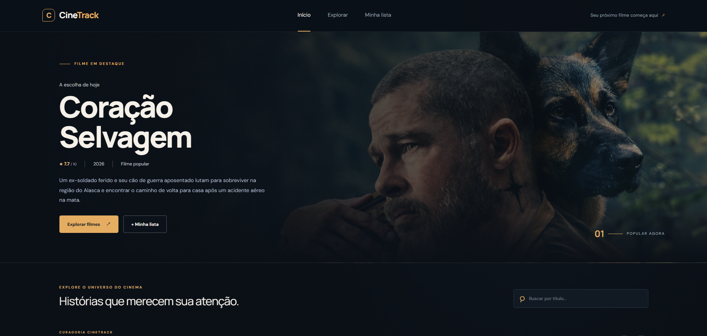
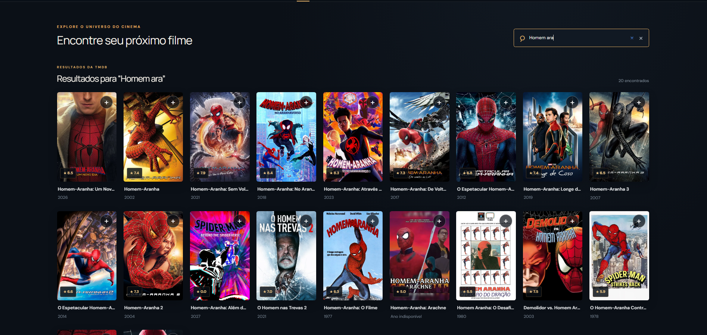
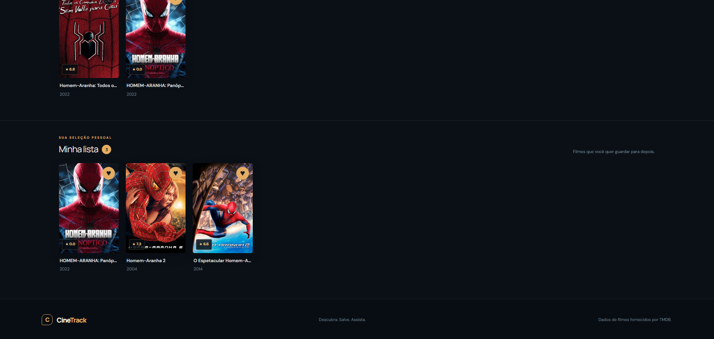

# CineTrack

**Discover movies. Explore new stories. Build your watchlist.**

CineTrack is a movie discovery application built with React and powered by the [TMDB API](https://www.themoviedb.org/). It allows users to explore popular and highly rated movies, search for titles, and manage a personal watchlist through a responsive and intuitive interface.

## Preview

### Home



### Movie Search



### My List



## Features

- **Movie Discovery:** Browse popular and highly rated movies.
- **Movie Search:** Search the TMDB catalog by movie title.
- **Personal Watchlist:** Add and remove movies from My List.
- **Local Persistence:** Keep your watchlist saved between visits using `localStorage`.
- **Responsive Design:** Enjoy the application on desktop and mobile devices.

## Technologies

- **React** – UI development
- **JavaScript (ES Modules)** – Application logic
- **Vite** – Development server and build tool
- **Tailwind CSS** – Styling
- **TMDB API** – Movie data and images
- **localStorage** – Local data persistence

## Getting Started

### Prerequisites

- Node.js
- npm
- A TMDB API Read Access Token

### Installation

1. Clone the repository:

   ```bash
   git clone